# Guía visual de los procesos docentes

Estos esquemas muestran qué aportar, qué hace el agente y qué revisa el profesor.
Las flechas indican el recorrido posible: no autorizan a ejecutar el siguiente
paso sin encargo. Moodle se utiliza mediante archivos e importación manual.

La organización sigue los procesos explicados en la charla **XIGAID — «E agora
que a IA pode facelo, que facemos nós?»**, especialmente las fichas sobre mapa,
actividades, bancos, modelos y devolución de comentarios. Los diagramas se han
redactado para el funcionamiento actual del plugin; no requieren los archivos
privados de la charla ni presentan sus demostraciones pendientes como verificadas.

## Elige tu recorrido

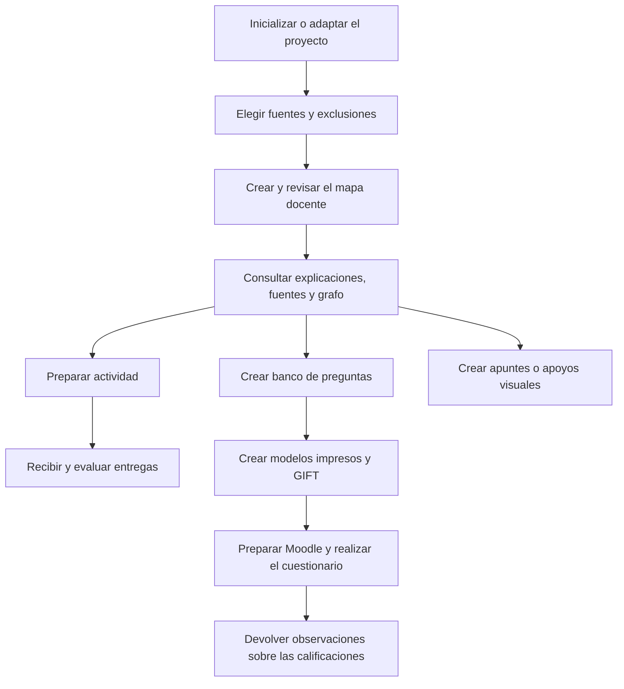

El mapa facilita reutilizar conocimiento, pero una tarea con adjuntos suficientes
puede hacerse sin él. En cualquier punto: **«¿Qué puedo hacer ahora?»** activa la
ayuda contextual. Se usa español conciso por defecto, salvo otra indicación.

## 1. Inicializar o adaptar el proyecto

**Petición:** «Prepara esta carpeta para mi asignatura y revisa cómo organizar lo que contiene».

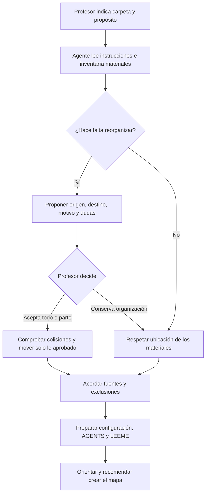

**Resultado:** originales en `fuentes/`, productos en `materiales_generados/`,
datos técnicos en `_datos_internos_proyecto/` y resultados en `resultados/`,
según la organización acordada. La inicialización no crea el mapa automáticamente.
[Skill de inicialización y adaptación](../skills/proyecto-docente-inicializacion-adaptacion/SKILL.md) ·
[Organización del proyecto](PROYECTO-DOCENTE.md).

## 2. Crear y consultar el mapa docente

**Petición:** «Crea el mapa con estas fuentes; explica los conceptos y enlaza sus referencias».

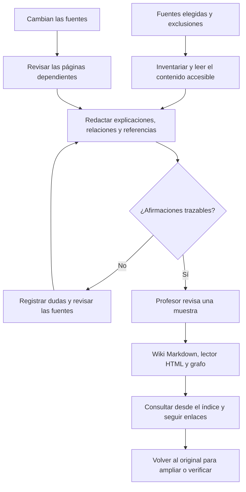

**Resultado:** `mapa-docente/` contiene una síntesis explicativa, no solo un índice.
Las entregas y notas quedan fuera del corpus; las vistas estudiantiles excluyen
contenido reservado. Regenerar las vistas no exige reescribir la wiki.
[Crear y visualizar](../skills/mapa-docente-creacion-visualizacion/SKILL.md) ·
[Consultar](../skills/mapa-docente-consulta/SKILL.md).

## 3. Diseñar una actividad mediante diálogo

**Petición:** «Diseñemos una actividad sobre estos materiales; acuerda conmigo evidencias y entregables».

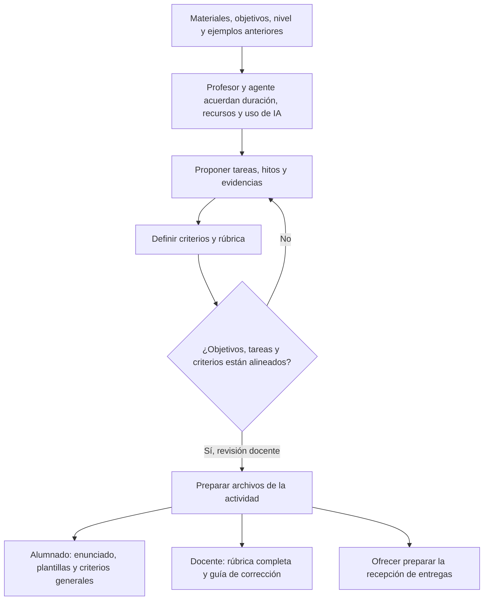

**Resultado:** conjunto en `materiales_generados/actividades/<actividad>/`.
Se diseña teniendo en cuenta el acceso a IA, sin exigir su uso por defecto:
justificaciones, contrastes y decisiones permiten observar comprensión.
[Preparar actividades](../skills/actividades-preparacion/SKILL.md) · [Guía](ACTIVIDADES.md).

## 4. Recibir y evaluar entregas

**Petición:** «Evalúa estas entregas con el enunciado y la rúbrica y prepara la hoja Moodle con notas y comentarios».

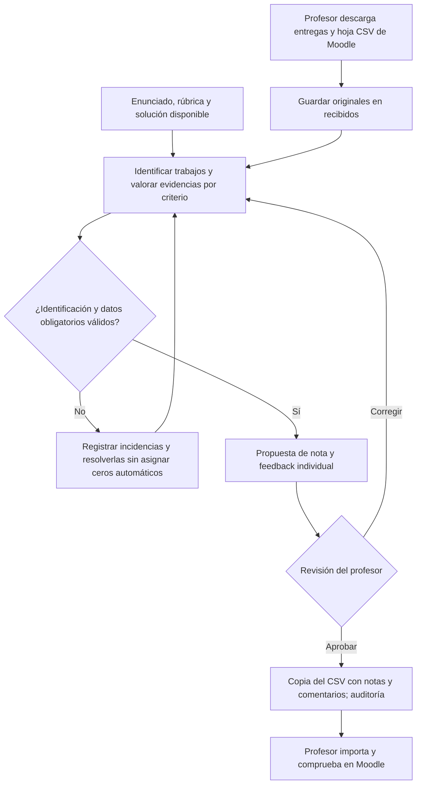

**Dónde poner los archivos:**

```text
resultados/<actividad>/<convocatoria>/
├── LEEME.md
├── recibidos/
│   ├── entregas/
│   └── hoja-original-moodle.csv
└── correccion/
    └── Informes, incidencias y copia del CSV para importar
```

La hoja puede abrirse en Excel, pero el intercambio de la utilidad es CSV.
No asociar personas por semejanza de nombres. La valoración cualitativa puede
avanzar mientras se resuelven incidencias; la exportación ambigua se bloquea.
[Evaluar actividades](../skills/actividades-evaluacion/SKILL.md) · [Calificaciones](CALIFICACIONES.md).

## 5. Crear bancos asociados a materiales

**Petición:** «Propón un banco para estos temas, con cobertura y variantes justificadas».

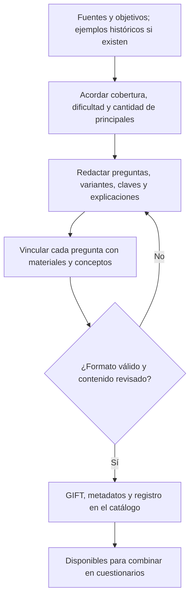

**Resultado:** `materiales_generados/bancos/<banco>/`, con archivos individuales,
sin ZIP por defecto. `01-A`, `01-B`… son variantes de una principal. Se parte de
cuatro modelos y se proponen hasta cuatro variantes pertinentes por principal;
el profesor ajusta la cantidad. Validar sintaxis no demuestra calidad pedagógica.
[Crear bancos](../skills/cuestionarios-bancos-preguntas-creacion/SKILL.md) · [Catálogo](BANCOS.md).

## 6. Componer los modelos para imprimir y evaluar

**Petición:** «Prepara modelos que cubran estos temas; propón cantidad de preguntas y duración».

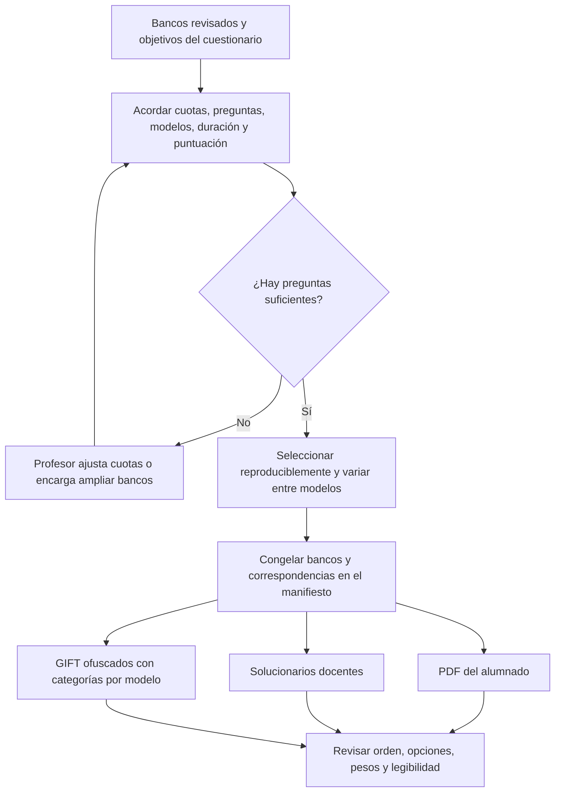

**Resultado:** `materiales_generados/cuestionarios/<cuestionario>/`, con
`alumnado/`, `docente/` y `_datos_internos/`. Ningún modelo repite una principal;
se busca diversidad sin prometer un óptimo. Emparejamiento queda fuera del
circuito impreso. El GIFT contiene claves y permanece reservado al docente.
[Crear modelos](../skills/cuestionarios-modelos-imprimir-evaluar/SKILL.md) ·
[Puntuaciones y límites](PUNTUACION-CUESTIONARIOS.md).

## 7. Preparar Moodle: trabajo del profesor

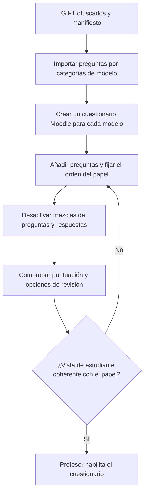

Categoría de ejemplo:
`RespuestasCuestionariosOffline/Talleres 5-8/Modelo 01`.
Importar GIFT no crea la actividad cuestionario ni garantiza su orden.
Los pesos negativos se conservan, pero hay que comprobar el comportamiento
real de la puntuación. [Preparación de Moodle](MOODLE.md).

## 8. Del papel a la nota: recorrido del alumnado

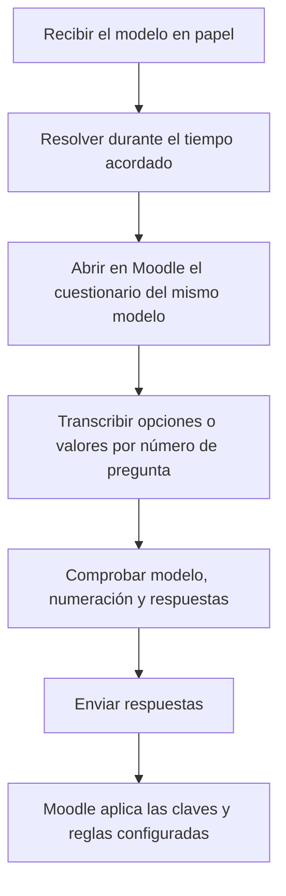

Moodle muestra «Pregunta 01» y «Respuesta A», etc., sin el enunciado original.
La ofuscación reduce lo expuesto en pantalla; no elimina la consulta por otros
canales. El profesor debe prever tiempo de transcripción y accesibilidad.

## 9. De las calificaciones a las observaciones útiles

**Petición:** «Añade observaciones de mejora con este detalle de respuestas, el manifiesto y la hoja de calificaciones; conserva las notas».

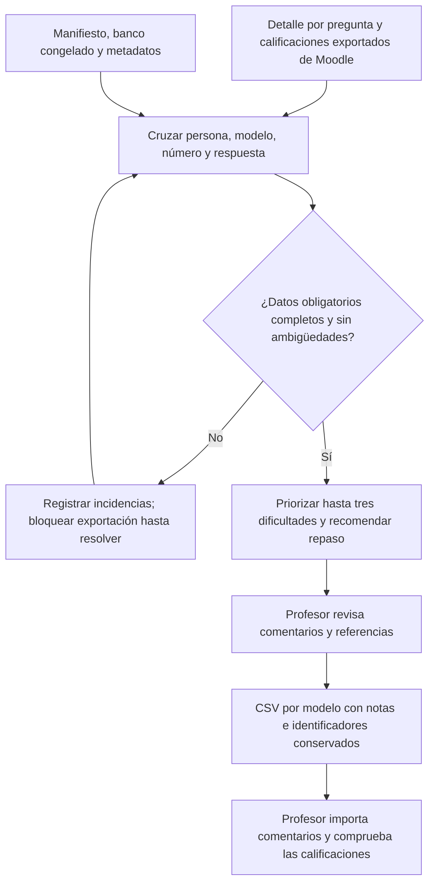

Una nota global no permite inferir dificultades conceptuales. No se reconstruye
la pregunta desde un banco modificado ni se deduce con certeza el razonamiento
del estudiante por una opción. Las recomendaciones enlazan material accesible al
alumnado y los no presentados quedan sin comentario.
[Observaciones sobre calificaciones](../skills/cuestionarios-observaciones-calificaciones-alumnado/SKILL.md).

## 10. Apuntes y apoyos visuales

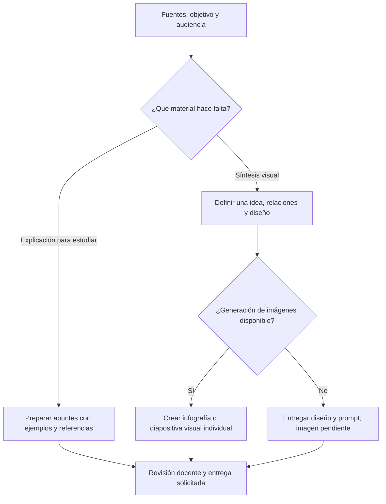

[Apuntes](../skills/apuntes-estudio-creacion/SKILL.md) e
[infografías](../skills/infografias-didacticas-creacion/SKILL.md) complementan los
recorridos anteriores. No se promete una presentación editable. Los borradores
no se incorporan automáticamente al corpus del mapa.

Para continuar: [ayuda y siguientes pasos](FLUJOS-DOCENTES.md),
[catálogo de skills](CATALOGO.md) y [ejemplo completo](../examples/recorrido-docente/README.md).
